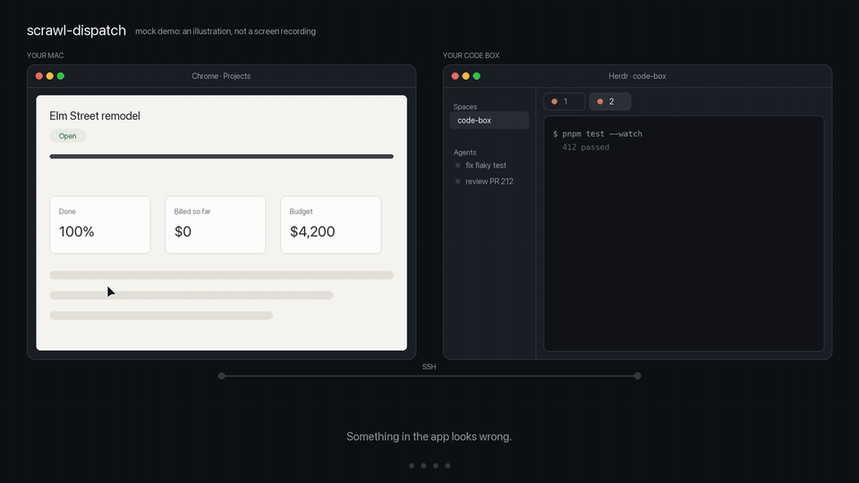

# scrawl-dispatch

Sends each finished [Scrawl](https://github.com/kitlangton/scrawl) capture to a coding agent on a
[Herdr](https://herdr.dev) machine. You finish a recording; about 5 seconds later Claude Code is
working on it in a new Herdr tab on your code box.

[](demo/demo.mp4)

The demo is an illustration drawn by [`demo/make-demo.py`](demo/make-demo.py), not a screen
recording. The 4.9 seconds in it is the time measured in a test with a simulated capture.

Scrawl has no "capture is done" hook yet
([kitlangton/scrawl#25](https://github.com/kitlangton/scrawl/issues/25)), so this is a launchd job
that watches the captures folder. Scrawl itself is not changed.

## What you need

- macOS with Scrawl installed.
- `hc` (herdr-core) on the Mac, with your machine in `hc machine ls`.
- Claude Code on the machine.

## Install

```sh
git clone https://github.com/bath/scrawl-dispatch && cd scrawl-dispatch
./scrawl-dispatch install code-box-miller    # your machine's name from `hc machine ls`
```

This copies the script to `~/.local/bin/scrawl-dispatch`, writes
`~/.config/scrawl-dispatch/config`, loads the launchd job `dev.bath.scrawl-dispatch`, and turns
dispatch on. Captures that exist at install time are never sent.

Then set the agent's folder in `~/.config/scrawl-dispatch/config`:

```sh
MACHINE=code-box-miller
MODEL=opus
EFFORT=medium
CWD=/home/miller/dev
```

Use a `CWD` that Claude Code already trusts on the machine. In an untrusted folder (the home
folder, for example) the agent stops at the trust question and waits for you.

## Use

```sh
scrawl-dispatch on        # new captures go to the machine
scrawl-dispatch off       # captures stay on the Mac
scrawl-dispatch status    # on or off, the settings, the last log lines
scrawl-dispatch send      # send the newest capture now; or: send <bundle>
scrawl-dispatch uninstall
```

The toggle is the file `~/.config/scrawl-dispatch/on`. The launchd job stays loaded when dispatch
is off; it only skips the send. A capture that finishes while dispatch is off is not sent later.

## What happens to a capture

1. Scrawl makes the bundle's folder when a recording starts. launchd sees the captures folder
   change and starts `scrawl-dispatch watch`.
2. The watcher waits for `summary.md`, the last file Scrawl writes.
3. It copies the contact sheet, `frames/`, `summary.md` and `scrawl.json` to
   `~/scrawl/captures/<bundle>` on the machine (tar over SSH).
4. It starts the agent in a new Herdr tab:
   `hc run --on <machine> --bg --no-parent --keep --label herdr.space=<id> -- claude "<summary>" --model opus --effort medium --add-dir <the copy>`.
   The prompt is the text Scrawl put on the clipboard, with its paths pointing at the copy.
5. It shows a macOS notification, then sends `frames-full/` and `contact-sheet-full.png`.
6. The watcher exits when no unfinished capture is left.

The video and the audio stay on the Mac. Scrawl still copies the capture to the clipboard.

## Settings

All in `~/.config/scrawl-dispatch/config` (a shell file):

| Setting | Default | Meaning |
| --- | --- | --- |
| `MACHINE` | none | The machine's name in `hc machine ls` |
| `MODEL` | `opus` | Claude Code's `--model` |
| `EFFORT` | `medium` | Claude Code's `--effort` |
| `CWD` | the machine's home | The agent's folder on the machine |
| `SPACE` | the newest terminal's space | The Herdr space the tab opens in |
| `NOTIFY` | `1` | `0` turns the macOS notification off |
| `CAPTURES` | `~/Library/Application Support/scrawl/captures` | Scrawl's captures folder; change it and install again |
| `GIVE_UP_MINUTES` | `180` | How long the watcher waits for a capture that never finishes |

## Limits

- Scrawl's capsule does not show the dispatch. The notification and the new Herdr tab do.
- The toggle is for all captures, not for one capture.
- The tab opens in the Herdr space of the machine's newest terminal. If the machine has no
  terminal in a Herdr space, the agent still runs (`hc ls`), but no Herdr window shows it. Set
  `SPACE` for that case.
- The log is `~/.local/state/scrawl-dispatch/log`.
